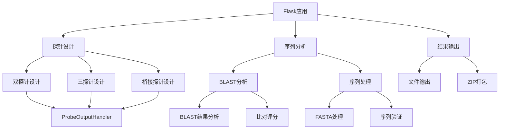

# Probe Generator

该脚本用于生成探针，并根据一些过滤条件进行探针筛选。最终输出满足条件的探针列表。

## 本地开发状态：2026-10-15

`fix/paired-specificity` 已快进合并到 `main`。完整近匹配检索、目标策略与亚基因组模式在 `5bdc4b7` 中，已于 2026-10-15 部署到服务器并通过真实请求验证；尚未推送 GitHub。第一阶段修复面向 Bo/Bju 双探针的特异性检查和最终筛选，随后将双探针单条及批量网页改为分步引导。服务器原有桥接探针数据、批处理脚本及三探针模板保留原样；双探针模板已在其基础上替换为新界面，沿用当前桥接库。原有桥接库更新与本轮功能修改分别提交，服务器运行方式和回滚步骤见 [部署说明](docs/deployment.md)。

多倍体及高同源拷贝背景下的未解决问题、相关代码与数据、开发顺序和验收条件，见 [当前问题与后续任务](docs/current_issues_and_next_steps.md)。

### 环境与启动

在本项目目录执行：

```bash
python3 -m venv .venv
source .venv/bin/activate
python -m pip install -r requirements.txt
python -m flask --app app run --host 127.0.0.1 --port 6789
```

### 管理员与空间清理

首次使用前在项目目录初始化管理员，账号由命令指定，密码会隐藏输入并要求重复确认（至少 12 位）：

```bash
source .venv/bin/activate
python -m flask --app app init-admin --username admin
```

启动后访问 `/admin`，或点击侧栏“空间管理”。管理员可以按类别、文件名查看占用并批量删除上传的基因组、探针文件和分析结果。基因组与其压缩源文件、BLAST 索引一起删除；双探针任务与任务内的上传参考、探针输出及 ZIP 一起删除；旧版三探针目录与同编号的下载 ZIP 一起删除。删除需要在页面再次确认，删除后原结果链接失效。共享参考正在被排队/运行任务使用时不能删除；进行中的任务、记录损坏或含符号链接的目录受到保护。内置 `resources/` 数据不在清理范围内。

账号、带盐密码哈希和会话密钥保存在 `instance/admin.json`，文件权限为 `0600`，不随 Git 提交。未初始化时管理功能不可用，没有默认密码或开放的网页注册入口。通过 `init-admin --username admin --reset` 可重设账号和密码，并使已有登录失效。初始化后重启服务；会话有效期为 8 小时。使用 HTTPS 时设置 `HCR_COOKIE_SECURE=1`。

标准启动脚本默认启用定期清理：

```bash
HCR_PYTHON="$PWD/.venv/bin/python" bash scripts/run_web.sh
```

服务收到首次请求时开始检查，此后每 24 小时清理一次**超过 3 个自然月**的分析结果。按双探针任务的完成/失败时间起算，未运行的准备任务按创建时间起算，中断任务按最近提交时间起算；没有时间记录的旧版输出按目录及文件的最新修改时间判断。清理包括 `uploads/split_results/`、`uploads/triplet_results/` 和 `probe_recommend_<任务ID>.csv`，会跳过排队、运行中的任务；参考基因组和其他上传文件不自动过期。`outputs/` 下的离线实验及回归数据不自动删除。管理员页面可查看过期占用、最近清理情况，并立即清理过期结果。

直接使用 `flask run` 时需设置 `HCR_CLEANUP_ENABLED=1` 启用；设置为 `0` 可关闭定期清理。调度随 Web 服务运行，停机期间不执行；重新启动后的首次请求会补做检查。CLI 命令不启动后台清理，可以先预览，再显式执行：

```bash
python -m flask --app app cleanup-results --dry-run
python -m flask --app app cleanup-results
```

管理员登录、CSRF、路径与符号链接边界、运行任务保护、保留期边界和重复调度测试：`python -m unittest discover -s tests -p test_admin.py -v`。当前队列和清理器都面向单进程部署；多进程部署需把清理调度和任务协调迁至独立服务。

### 亚基因组编号生成

侧栏“序列工具 → 亚基因组编号”（`/subgenomes`）支持两种方式生成两列 `transcript_id,subgenome` CSV，可上传到参考库管理页作为亚基因组归属文件：

- **多个 FASTA**：为每个文件指定亚基因组名称，默认取文件名去掉 `.fa/.fasta/.fna` 和 `.gz` 后的名称；提取各文件标题的第一个编号后合并为一个 CSV。同一亚基因组允许提供多个文件。
- **单个 FASTA 按编号特征匹配**：逐条填写“编号特征 → 亚基因组”。`X` 或 `x` 代表一位数字，例如 `A0X → A` 匹配 `A01`，`Axx → A` 匹配 `A01/A12`；默认按编号中包含特征、不区分大小写匹配，也可改为编号开头、结尾或区分大小写。需要匹配字母 X 本身时选择“原文匹配”。特征不是正则表达式，其他字符均按原文匹配。

支持普通 FASTA 和 gzip 文件，不把输入或生成的 CSV 保存到 `uploads/`。生成后先展示各亚基因组数量、前 100 条归属及问题编号；CSV 下载包含完整结果。重复编号按大小写不敏感合并，一个编号归入多个亚基因组时禁止下载归属文件，必须先解决冲突；未匹配编号会明确列出，只有确认后才能仅导出已匹配部分，问题编号也可完整下载。此工具只按用户提供的文件划分或编号特征生成归属，不验证其生物学含义。

验证：`python -m unittest discover -s tests -p test_subgenome_generator.py -v`。

### 参考库管理

侧栏“序列工具 → 参考库管理”（`/references`）统一列出 `uploads/` 顶层的共享 FASTA。所有用户都可上传、修改显示名称、配置“多倍体 / 非多倍体 / 尚未配置”、计算哈希，并在设计页面选择。删除参考及配套索引仅限管理员；在用参考仍由空间管理的运行任务保护规则限制删除。

上传时流式计算 SHA-256，gzip 文件先解压再计算，因此同一份 FASTA 改名或重新压缩不会重复保存。这里比较的是解压后的文件字节，不把不同换行、标题或序列排列的文件视为同一份。旧参考自动列出，首次去重时计算并缓存哈希；页面也可单独计算哈希与序列数。同名但内容不同的参考会附加哈希片段后另存，不覆盖原 FASTA 和索引。格式错误、重复编号或损坏 gzip 不会留下部分上传。

配置和哈希缓存保存在 `instance/references.json`，不放入 Git。参考库上传或修改配置时可同时上传两列亚基因组归属文件，保存为 `uploads/<参考文件名>.subgenomes.tsv`；页面显示覆盖数量。归属不根据文件名推断，替换时会校验编号交集及冲突。

双探针设计选择已配置的多倍体参考时，才显示“是否考虑多套染色体”（默认不勾选）。勾选后读取参考库已保存的归属，自动使用已有亚基因组策略；同一亚基因组及额外允许编号进入允许集合，其他配对按排除阈值判定。未勾选时不读取归属、不自动启用亚基因组策略。缺少有效归属或目标未标注时提示补充配置。输入检查时为任务复制归属快照并记录 SHA-256，之后修改参考库配置不会改变已准备的任务。删除共享参考时归属文件随参考及索引一并删除。

旧三探针上传接口也使用同一套上传去重，不再按原文件名覆盖共享参考。双探针任务中的隔离参考上传仍仅用于当前任务；如需共享、配置倍性和复用去重，请先在参考库管理页添加，再从设计页选择。

验证：`python -m unittest discover -s tests -p test_reference_library.py -v`。

已验证的本地环境为 Python 3.9.6、Biopython 1.81、NumPy 1.26.4。依赖文件已补齐 Flask、Requests；原 Biopython 1.78 不提供代码使用的 `gc_fraction` 接口。

BLAST+ 按以下顺序查找：`HCR_BLAST_BIN` 指定的目录、系统 PATH、项目 `.tools/ncbi-blast-*/bin`。本机已安装并核验 [NCBI BLAST+ 2.17.0 Apple Silicon 版本](https://ftp.ncbi.nlm.nih.gov/blast/executables/blast+/2.17.0/)，安装来源及校验值保存在 `.tools/blast-install.json`。其他机器需安装适合其平台的 BLAST+，无需修改代码中的绝对路径。

```bash
# 仅在使用其他安装目录时设置；目录内须包含 blastn 和 makeblastdb。
export HCR_BLAST_BIN=/path/to/ncbi-blast/bin
```

参考文件为 `uploads/bol_bju_cdna.fasta`，包含 155,577 条 Bo/Bju cDNA。它与项目内构建的索引对应，SHA256 为 `5de12a5800a09889b73b901b12787c16fb6461d1c5a2de42e1864109726921d0`。运行双探针入口或历史复核脚本时，会为尚无索引的 FASTA 调用 `makeblastdb -parse_seqids`。替换 FASTA 时须重新构建其配套索引。

双臂配对检索由 `src/common/paired_scan.cpp` 完成，它不依赖 BLAST 索引，直接流式读取同一份 FASTA。首次调用时用 `c++ -std=c++17 -O2` 编译到 `.tools/paired_scan/<源码哈希>/`，源码改动会自动重新编译；也可用 `HCR_SCAN_BIN` 指定预编译二进制。没有编译器且未设置该变量时直接报错，不会退回近似检索。

```bash
# 仅在使用预编译二进制时设置。
export HCR_SCAN_BIN=/path/to/paired_scan
```

### 双探针筛选规则

1. 候选生成枚举每个仍能放下两臂及臂间间隔的起点，不再按三臂长度预留空间，也不在找到一个候选后占用位置；重叠候选都会保留，组合之间的间距改由最终筛选处理。
2. 双臂配对检索是完整的无缺口替换扫描：把较长一臂切成 `K+1` 段不重叠种子，任何每臂不超过 `K` 个替换的比对必含一段精确种子，每个种子位置都按设计间隔逐碱基核验两条整臂。在"正向转录本、无插入缺失、每臂最多 3 个替换"的范围内结果完整，不是 BLAST 近似检索。含非 ACGT 碱基的窗口跳过并单独计数。
3. 单臂 BLAST 结果仍保留整臂延伸核验后的明细、坐标、方向和错配位置，但只用于质量排序，不再决定排除。
4. 分开记录目标转录本、允许共同检测的转录本、同物种其他转录本、跨物种转录本和物种无法识别的转录本。物种暂按 `Bo` / `Bju` 编号前缀识别，不区分大小写。
5. 目标策略决定哪些转录本算预期信号：**物种模式**（默认）同物种其他转录本只参与排序；**严格模式**排除目标以外的所有非允许配对；**允许集合**在填写允许转录本后生效；**亚基因组模式**允许目标所属亚基因组内的全部转录本，其余同物种转录本按非允许处理。非允许配对的排除阈值单独配置（每臂最多错配数，默认 0 即只排除完全配对），该阈值未经实验校准。
6. 亚基因组归属只来自提供的文件，不由编号拼写推断。两种等价的提供方式：**按亚基因组分多个 FASTA 上传**，每个文件算一个亚基因组、名称取自文件名，服务器合并为一份参考并生成归属文件；或**单一参考加一个两列文本文件**，第一列转录本编号、第二列所属亚基因组（制表符、逗号或空格分隔，可带表头和 `#` 注释）。归属文件中没有的转录本记为未标注，永远不会因归属而进入允许集合；目标本身未标注时亚基因组模式直接报错，不会退回其他判定。
7. 指定参考库时，缺少评估、缺少目标编号、未找到目标完全配对，以及阈值内的非允许配对，均不进入保留集合。扫描或 BLAST 执行失败、超时、输出截断都直接报错，不返回"未检出风险"。未指定参考库时仅做原有质量筛选，输出明确标记特异性未评估。
8. 剩余候选按实际单臂质量分、配对特异性分及原有连接位点规则排序。目标与允许转录本的配对不产生特异性惩罚。各阈值按不同转录本数统计，重复位点保留明细但不重复加分。
9. JSON 坐标统一为 **1-based inclusive**，BED 保留标准 0-based half-open。`inner_gap` 是同一对两臂间的空闲碱基数，网页入口当前为 0；`min_gap` 传入最终筛选，表示不同已选组合之间至少留出的空闲碱基数。

配对分数按每臂最大错配数的互斥档位 0/1/2/3 累加：跨物种和未知物种权重为 100/20/6/2，同物种其他转录本为 10/2/1/0.5。它们是排序权重，不是实验成功率。`specificity_score: null` 表示未评估；数值 0 仅表示本次检索未观察到额外配对惩罚。每对结果保留 `keep`、`reason_code` 和 `reason`，排除原因区分完全配对（`*_exact_pair`）与阈值内近似配对（`*_near_pair`）。每个任务的结果同时保存 `target_policy`（亚基因组模式还包含归属文件路径和目标所属亚基因组）和 `search`（参考、方向、每臂阈值、是否检查插入缺失、耗时、峰值内存）。亚基因组模式下每个配对命中附带 `subject_subgenome`。

使用参考库时须填写对应的目标转录本编号。批量页面 CSV 的列为 `任务名称,桥接探针编号,目标转录本编号,保留数量,允许共同检测的转录本`；应使用参考库中的完整编号。输入 Bo/Bju 序列时，可从所选参考库提取，或选择直接粘贴序列并填写相应编号。

**插入缺失仍未复核。** 完整检出只覆盖替换错配，不等于覆盖所有实验结合机制。

### 双探针分步网页

打开 `/split`（单条）或 `/split/batch`（批量），两个入口共用同一套参数及计算流程：

1. **序列与参考**：填写任务名、目标转录本编号和桥接编号，或上传/粘贴批量 CSV。默认选中本地 Bo/Bju 参考库；也可上传 FASTA/gzip，或明确选择不做特异性检查。点击“检查输入并继续”后，服务器核对编号、序列及参考信息；有错误时保留输入并列出具体行号。
2. **参数与检查**：显示实际提取的目标编号、序列长度、桥接编号和每行保留数量。默认最多保留 5 对、组合间距 2 nt；臂长、Tm、GC 等放在高级参数中。单条和批量使用相同默认值。
3. **结果复核**：显示本次候选、跨物种完全配对、按目标策略排除、保留待复核及特异性未评估数量。可按任务和状态筛选，展开 L/R 序列、坐标及配对命中证据，然后下载完整 ZIP。保留不表示实验特异性合格；页面说明检索范围，并在有任务未完成扫描时改为提示未评估，而不是声称未检出。

第一步可为单条任务填写"允许共同检测的转录本"；选择多倍体共享参考时，勾选“是否考虑多套染色体”即可复用参考库中已保存的归属，无需再次上传。单次任务也可按亚基因组分文件上传。第二步确认目标判定模式和非允许配对排除阈值。选择亚基因组模式时，第一步填写的允许转录本作为额外允许项；其余情况下填写了允许转录本的任务按允许集合判定。未提供归属信息就选择亚基因组模式，或目标转录本未标注，都会在第二步报错并指出具体任务。

CSV 支持无表头的 3–5 列，或以下标准表头；第 4 列留空时使用第二步默认值，填入 1–10 时覆盖该行的保留上限；第 5 列可用分号或空格分隔多个允许共同检测的转录本，填写后该行按允许集合判定：

```csv
task_name,BP_ID,gene_id,max_selected,allowed_ids
ABCG13_demo,BP_0079,BjuVA06G01970,5,BjuVB06G29330
```

目标优先从所选参考库提取，不再只查内置 TAIR。目标编号按大小写不敏感的精确匹配查找；一个基因对应多个转录本时要求完整编号，不自动选第一个。粘贴序列时保留目标编号和用户序列。**本次候选编号只在当前设计中有效，不与历史实验探针对编号对应。**

结果保存到 `uploads/split_results/<任务ID>/`：`request.json` 记录输入，`result.json` 保存网页结果，`output/` 保存完整输出，`results.zip` 用于下载。上传参考隔离保存在当前任务目录，不覆盖已有参考。结果 URL 为 `/split/results/<任务ID>`，可在同一应用中重新打开；新参数需要重新检查输入以创建新任务。网页任务由单个后台线程按顺序计算，可从 `/jobs` 查看进度并重新打开结果；旧版一次性 POST 仍同步返回 ZIP。未完成输入检查的失败目录会清理，已准备及完成任务按前述三个月保留策略清理。

网页入口由 `scripts/split_web.py` 注册，输入校验与结果存储位于 `scripts/split_workflow.py`，共用模板为 `templates/split_wizard.html`，静态资源为 `static/split-wizard.css` 和 `static/split-wizard.js`。`POST /split`、`POST /split/batch` 仍可直接执行并返回 ZIP，新界面使用先检查输入、再运行的两个接口。

本轮验证（完整检索与目标策略）：

- 扫描器与暴力枚举一致：22 条随机查询在含边界、重复、模糊碱基的合成参考上，每臂 0 和 3 个替换的结果与穷举完全相同，错配位置逐条核对。运行：`python -m unittest discover -s tests -p test_paired_scan.py -v`。
- 397 对历史候选在真实参考上重跑：每臂 0/1/2/3 替换的跨物种候选数为 155/326/372/388，与独立基线一致；2,157 个配对位点的坐标、错配数、错配位置和匹配片段逐条相同，原 BLAST 流程漏掉的 28 对全部补回。结果在 `outputs/phase2_regression/`，原流程结果保留在 `outputs/phase1_regression/`。
- 真实 HTTP 运行覆盖三种目标策略（物种、严格、允许集合），同一目标 314 对候选：物种模式按完全配对排除 105 对，严格模式和允许集合排除 133 对，三者的 ZIP 与网页结果一致，`search` 均为完成状态。记录在 `outputs/phase2_http_e2e.log`。
- 亚基因组模式在真实参考上验证：两列归属文件覆盖 94,680 条 Bju 转录本（A 47,895、B 46,785），其余 60,897 条记为未标注；同一目标（亚基因组 A）的 59 个配对命中归入允许、321 个归入同物种其他亚基因组并被排除，排除数由物种模式的 105 对增至 133 对。按亚基因组分文件上传的 800 条子集合并为一份参考并自动生成归属文件，归属与文件划分一致。记录在 `outputs/phase2_subgenome_e2e.log`；该验证使用按编号拼写生成的示例归属文件，只为检验机制，不是权威注释。
- 全套测试共 62 项：53 项通过，5 项失败、4 项错误均与第一阶段确认的原始基线相同，没有新增失败。
- 耗时与内存：397 对分 13 次扫描合计 71.8 s，扫描进程峰值常驻内存 2.4 MB；单条真实设计（2,320 nt、314 对候选）扫描 17.1 s，整个设计 36.8 s。

以上均为计算验证，不新增实验下单清单。候选数由 33 对增至 314 对，是因为候选生成不再提前占位；三探针页面及其特异性判定本轮未迁移。上一轮的网页验证记录仍在 `outputs/guided_ui/verification.json`，修改前的网页文件在 `outputs/guided_ui_baseline/`。

### 历史回归与验证

历史数据位于 `data/probe_audit_20261014/`，属于本地同步输入；参考库、输入、环境和输出均不随代码提交。复现命令：

```bash
source .venv/bin/activate
python -m unittest discover -s tests -p test_paired_specificity.py -v
python -m unittest discover -s tests -p test_probe_table.py -v
python -m scripts.recheck_historical_pairs \
  --audit-file ../analysis/20261014_probe_audit/results/audit.json
```

`--audit-file` 仅用于与此前独立扫描结果比较，不参与本轮检索或筛选；没有该文件时可以省略。结果保存在 `outputs/phase1_regression/`，包括逐臂匹配、13 个基因的候选判断和 `summary.json`。历史编号及原有完整合成序列均保持不变。

| 验证项 | 结果 |
| --- | ---: |
| 历史候选 | 397 对 |
| 找到目标完全配对 | 397 对 |
| 跨物种完全配对 | 155 对，与独立复核的候选编号完全一致 |
| 其中已购买的探针 | 7 对，全部排除 |
| 其中原程序自动保留的探针 | 48 对，全部排除 |
| 本次每基因最多保留 5 对、间距 2 nt | 64 对旧候选；其中跨物种完全配对为 0 |

**64 对是对历史 397 对的重新筛选，不是新设计或已验证的合成清单。** 这轮未优化候选生成算法。

新增的 11 项单元测试全部通过。全套测试运行 30 项，有 5 项失败、4 项错误；在同步时保存的未修改代码快照中复现了相同的 9 项问题，见 `outputs/phase1_test_comparison.json`。它们涉及已缺失的旧模块、旧测试与当前 GC/poly-N/连接位点语义不一致，以及小写序列处理。

使用真实 Bo/Bju 库对 `/split` 和 `/split/batch` 分别执行 ABCG13 的完整请求，两者均返回 ZIP：各生成 38 对技术测试候选，排除 12 对跨物种完全配对，保留 5 对。已核验坐标、目标匹配、筛选间距参数及导出 CSV 的编号和序列。记录见 `outputs/phase1_web_smoke/summary.json`；这些接口测试输出不作为实验设计建议。

### 已知限制与下一步

BLAST 用于提供候选命中位置，**带错配搜索不穷尽**。与此前独立无缺口扫描相比，按“某对候选是否具有跨物种配对”统计：

| 每臂最多替换数 | 独立扫描检出 | 当前 BLAST 流程检出 |
| --- | ---: | ---: |
| 0 | 155 | 155 |
| 1 | 326 | 326 |
| 2 | 372 | 351 |
| 3 | 388 | 360 |

当前流程在每臂最多 3 个替换范围内漏掉了 28 对候选的跨物种配对，其中 5 对进入了上述 64 对重筛结果。比较明细写入回归摘要。这说明“零惩罚”不能用作特异性合格结论；候选用于合成前应采用完整近匹配复核，并补查插入缺失。

下一步优先补足近匹配检索，再处理既有候选生成的边界与覆盖问题，并结合实验组合、图像和对照确定实验方案。三探针流程尚未迁移到新的双臂配对判定。

## 用法

1. 安装依赖

确保已安装以下依赖：
- Python 3.x
- 相关Python库（具体依赖见requirements.txt）
- BLAST软件（如果使用了BLAST功能）

2. 准备输入文件

- `seq.txt`：包含待处理序列的文本文件。

3. 运行脚本

```bash
python probe_generator.py --input seq.txt --probe-size 50 --initiator-type B1 --polyN 2 --min-gc 0.3 --max-gc 0.5 --output probes.txt --blastdb blastdb.fasta
```

参数说明：

--input：输入序列文件的路径。
--probe-size：探针的大小。
--initiator-type：选择的初始化器类型。
--polyN：Poly N过滤的阈值。
--min-gc：GC含量过滤的最小阈值。
--max-gc：GC含量过滤的最大阈值。
--output：输出文件的路径。
--blastdb：可选参数，BLAST数据库的路径。如果提供了该参数，将基于BLAST结果进行探针过滤。

查看结果

脚本会生成一个包含满足条件的探针列表的输出文件（probes.txt）。你可以查看该文件来获取生成的探针信息。

> 以上为原单探针脚本用法。当前双探针流程的 BLAST 配置见前面的“环境与启动”。

## Flask应用

网页端的 Flask 依赖已包含在 `requirements.txt` 中，也可单独安装：

```bash
pip install flask
```

运行方法

```bash
python app.py
```

## 代码结构与依赖关系

### 主要模块

1. 探针设计模块
- 双探针设计 (Dual Probe)
- 三探针设计 (Triple Probe) 
- 桥接探针设计 (Bridge Probe)

2. Web应用模块
- Flask应用服务
- 探针设计接口
- 结果展示

3. 工具模块
- FASTA文件处理
- BLAST分析
- 序列分析工具

### 函数依赖关系图



### 核心功能模块说明

1. 探针设计模块
- `DualProbeDesigner`: 双探针设计类
- `TripleProbeDesigner`: 三探针设计类
- `BridgeProbeSystem`: 桥接探针系统类

2. 输出处理模块
- `ProbeOutputHandler`: 探针结果输出处理
- 支持CSV、详细文本等多种输出格式
- 包含BLAST分析结果整合

3. 序列分析工具
- `load_fasta()`: FASTA文件加载
- `load_alias()`: 基因别名加载
- `analyze_blast_results()`: BLAST结果分析

4. Web应用路由
- `/split`: 双探针设计接口
- `/triplet`: 三探针设计接口
- `/bridge`: 桥接探针设计接口

### 文件结构

```
.
├── app.py                    # Flask应用主文件
├── scripts/
│   ├── batch_dual_probe.py   # 双探针批处理
│   ├── batch_triplet_probe.py # 三探针批处理
│   ├── bp_suggestion.py      # 桥接探针建议
│   └── utils.py             # 通用工具函数
├── src/
│   ├── dual_probe/          # 双探针设计模块
│   ├── triple_probe/        # 三探针设计模块
│   └── bridge_probe/        # 桥接探针模块
└── resources/               # 资源文件
```
